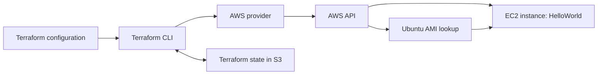

# Descomplicando Terraform

This repository contains notes, diagrams, and hands-on exercises developed while following the Infrastructure as Code (IaC) lessons in the **LINUXtips Terraform Professional** course.

**Course:** [LINUXtips — Terraform Professional: Infrastructure as Code (IaC)](https://linuxtips.io/terraform-professional/)

This repository brings together a small EC2 deployment, an S3 remote backend configuration, and diagrams explaining how Terraform connects configuration, providers, cloud APIs, and state.

## What has been implemented

- Automatic discovery of an official Ubuntu Server 22.04 LTS AMI.
- An EC2 instance using the selected AMI and the `t3.micro` instance type.
- A `Name = "HelloWorld"` tag to identify the instance.
- An S3 backend configuration for storing Terraform state remotely.
- A provider dependency lock file for reproducible initialization.
- Git ignore rules for local Terraform data, state, credentials, and other sensitive files.
- Two editable diagrams covering Terraform's workflow and remote state.

These describe the configuration in this repository; they do not establish whether resources are currently running in AWS.

## Repository structure

```text
.
├── .gitignore                     # Files excluded from version control
├── .terraform.lock.hcl            # Selected provider version and checksums
├── README.md                      # Project documentation
├── backend.tf                     # S3 remote state configuration
├── main.tf                        # Ubuntu AMI lookup and EC2 instance
├── plano                          # Saved binary Terraform plan artifact
└── diagrams/
    ├── terraform.drawio           # Terraform components and workflow
    └── remote-backend.drawio      # Shared state stored in S3
```

Terraform reads all `.tf` files in this directory as one configuration. The filenames organize the code; `backend.tf` and `main.tf` are not separate deployments.

## How the infrastructure works



### 1. Ubuntu AMI discovery

The `data "aws_ami" "ubuntu"` block in [`main.tf`](main.tf) looks up an existing Amazon Machine Image instead of creating one.

| Setting | Purpose |
| --- | --- |
| `most_recent = true` | Selects the newest image matching the filters. |
| `ubuntu/images/hvm-ssd/ubuntu-jammy-22.04-amd64-server-*` | Matches Ubuntu Jammy 22.04 server images for the AMD64 architecture. |
| `virtualization-type = hvm` | Restricts results to hardware virtual machine images. |
| `owners = ["099720109477"]` | Restricts the lookup to Canonical's AWS account. |

The result is referenced as `data.aws_ami.ubuntu.id`. AMIs are regional, so the lookup runs in the region selected for the AWS provider.

Because the configuration selects the most recent matching image, a future plan can select a newer AMI and propose replacing the instance. Review each plan before applying it.

### 2. EC2 instance

The `resource "aws_instance" "example"` block in [`main.tf`](main.tf) declares the instance Terraform will manage.

| Setting | Value | Meaning |
| --- | --- | --- |
| `ami` | `data.aws_ami.ubuntu.id` | Boots the image found by the data source. |
| `instance_type` | `t3.micro` | Sets the instance's compute size. |
| `tags.Name` | `HelloWorld` | Provides a recognizable name in AWS. |

`aws_instance.example` is the resource's Terraform address. `HelloWorld` is its AWS tag, so these names serve different purposes.

Referencing the AMI data source creates an implicit dependency: Terraform resolves the image before creating the instance.

The configuration does not define a VPC, subnet, security group, SSH key pair, IAM instance profile, or startup script. It relies on AWS defaults where applicable, including an available default VPC and default subnet in the deployment region. It does not configure an application or SSH access.

### 3. Remote state in S3

[`backend.tf`](backend.tf) configures the following backend:

```hcl
terraform {
  backend "s3" {
    bucket = "terraform-csarsantos96"
    key    = "cesar-backend.tfstate"
    region = "us-east-1"
  }
}
```

| Setting | Purpose |
| --- | --- |
| `bucket` | Names the existing S3 bucket that stores state. |
| `key` | Sets the state object's path inside that bucket. |
| `region` | Identifies the AWS region containing the bucket. |

Terraform state maps resource addresses such as `aws_instance.example` to actual AWS resources. Terraform uses that mapping when planning updates and deletions.

Storing state remotely lets different working directories use the same state. The backend configuration does **not** create the bucket. Provision the bucket separately and ensure your credentials can access it before initialization.

The backend's `region` applies to the S3 bucket; it does not configure the EC2 deployment region. No explicit state locking configuration is included, so coordinate operations and avoid concurrent applies against this state.

### 4. Provider dependency lock file

[`.terraform.lock.hcl`](.terraform.lock.hcl) records AWS provider version **6.70.0** and its package checksums. Terraform uses this selection during initialization, and the checksums help verify downloaded provider packages.

Keep the lock file in version control. The generated `.terraform/` directory contains local initialization data and downloaded providers and is ignored by Git.

There is currently no explicit `provider "aws"` block or `required_providers` block. Terraform infers the AWS provider from the resource types, and the provider obtains its settings from the execution environment. The repository also does not declare a required Terraform CLI version.

### 5. Git ignore rules

[`.gitignore`](.gitignore) excludes generated or potentially sensitive files, including:

- `.terraform/` working directories.
- State files and state backups.
- Terraform crash logs.
- `.tfvars` and `.tfvars.json` variable files.
- Local override files and Terraform CLI configuration files.
- Private key files ending in `.pem` or `.key`.

The saved plan named `plano` is not covered by these rules. Saved plans can contain sensitive values; treat them as local artifacts and inspect them before sharing.

## Running the project

### Prerequisites

- Terraform CLI installed and available in your terminal.
- AWS credentials configured through an AWS profile or another supported credential source.
- Permissions to look up AMIs, manage the EC2 instance, and access the backend bucket.
- An existing S3 backend bucket matching `backend.tf`, or an updated backend configuration pointing to your own bucket.
- A deployment region with a default VPC and default subnet available for this configuration.

EC2 instances and associated AWS resources can incur charges.

### 1. Configure your AWS environment

For example, with an existing AWS CLI profile:

```bash
export AWS_PROFILE=your-profile
export AWS_REGION=us-east-1
aws sts get-caller-identity
```

Replace `your-profile` with your configured profile. The identity check requires the AWS CLI and helps confirm which account will receive the deployment. Choose the deployment region deliberately; the example uses the same region as the backend bucket.

### 2. Initialize Terraform

From the repository root:

```bash
terraform init
```

Initialization configures the S3 backend and installs the provider selected in the lock file.

If you are moving an existing local state to this backend, back up the state first, then use:

```bash
terraform init -migrate-state
```

Review the migration prompts carefully. If you are only updating local backend settings to use an already established remote state, use `terraform init -reconfigure` instead. Reconfiguration does not migrate state.

### 3. Check formatting and configuration

```bash
terraform fmt -check
terraform validate
```

The first command checks HCL formatting; the second checks configuration validity. Validation does not confirm that your AWS permissions, backend access, or default network are ready for deployment.

### 4. Generate and review a plan

```bash
terraform plan -out=plano
terraform show plano
```

The plan compares the configuration, state, and AWS resources to calculate proposed changes. `-out=plano` saves those actions in a binary plan file, replacing any existing artifact at that path.

Generate a fresh plan for your account and current configuration before applying. The existing `plano` artifact may reflect earlier configuration or state.

### 5. Apply the reviewed plan

```bash
terraform apply plano
```

This executes the saved plan and updates the remote state. Applying a saved plan does not ask for another approval, so review it first.

To inspect the managed resources afterward:

```bash
terraform state list
terraform show
```

No output values are declared in this project; inspect the state or the AWS console for instance details.

### 6. Clean up the deployment

When you finish the lab:

```bash
terraform destroy
```

Review the deletion plan and confirm only when it targets the intended resources. This removes resources managed by the current configuration and state, including the EC2 instance. The separately provisioned backend bucket remains available.

## Diagrams

- [`terraform.drawio`](diagrams/terraform.drawio) explains the relationships between HCL configuration, Terraform, state, providers, and the cloud API.
- [`remote-backend.drawio`](diagrams/remote-backend.drawio) illustrates multiple Terraform clients accessing a shared state file in S3.

Open these files with diagrams.net or a compatible draw.io editor to view and edit them.

## Current scope

This is a focused learning lab with one EC2 resource and one AMI data source. The S3 bucket is an external prerequisite. Custom networking, modules, input variables, outputs, application provisioning, and automated delivery pipelines are not implemented yet.

## Implementation update: multiple AWS regions

This section updates the earlier implementation and scope descriptions while preserving the original notes above.

- [`providers.tf`](providers.tf) now declares `hashicorp/aws` in `required_providers`, with the version constraint `~> 6.0`.
- The default AWS provider explicitly uses `us-east-1`.
- A second AWS provider uses the alias `west` and the region `us-west-1`.
- [`main.tf`](main.tf) now declares a separate Ubuntu AMI lookup and EC2 instance for each region.

| Region | Provider reference | AMI data source | EC2 resource |
| --- | --- | --- | --- |
| `us-east-1` | Default `aws` provider | `data.aws_ami.ubuntu` | `aws_instance.example` |
| `us-west-1` | `aws.west` | `data.aws_ami.ubuntu-west` | `aws_instance.example-west` |

Both instances use `t3.micro` and the `Name = "HelloWorld"` tag. Each AMI lookup selects the most recent matching Canonical Ubuntu Server 22.04 LTS AMD64 HVM image in its own region. The west-region data source and instance both explicitly select `provider = aws.west`.

The current configuration therefore declares two EC2 instances and two AMI data sources. The explicit provider regions in `providers.tf` determine where these resources are managed; the earlier environment-variable example does not override those configured regions. Each region needs the default networking described in the prerequisites.

The S3 backend remains in `us-east-1` and stores the state for this configuration, including both regions. The existing `terraform init`, `terraform validate`, and plan workflow applies to the combined configuration. Review a fresh plan to see the actions proposed for both regions.

An empty [`variables.tf`](variables.tf) file has also been added to the working directory; no input variables are declared yet. These updates describe the files present in the project and do not confirm that the infrastructure has been applied in AWS.

## Implementation update: instance type variable and regional tags

This update supersedes the earlier notes about an empty `variables.tf`, the absence of input variables, and identical instance names. The previous sections are preserved as a record of the earlier configuration.

[`variables.tf`](variables.tf) now declares the `instance_type` input variable:

```hcl
variable "instance_type" {
  type        = string
  description = "EC2 instance type for the web server"
  default     = "t3.micro"
  sensitive   = true
}
```

Both EC2 resources in [`main.tf`](main.tf) now use `instance_type = var.instance_type`. The default remains `t3.micro`; overriding this variable changes the configured instance type for both regions.

| EC2 resource | Region | Current `Name` tag |
| --- | --- | --- |
| `aws_instance.example` | `us-east-1` | `HelloWorld` |
| `aws_instance.example-west` | `us-west-1` | `HelloWorld-west` |

To use the default instance type, follow the existing plan workflow. To choose another type for both instances, generate and review a new plan with an explicit variable value:

```bash
terraform plan -var='instance_type=t3.small' -out=plano
terraform show plano
```

The `sensitive = true` setting marks the variable for redaction in Terraform's normal CLI output. It does not encrypt the value or prevent it from being stored in state or saved plan files.

The repository structure now also includes `providers.tf` for the AWS provider requirement and regional configurations, and `variables.tf` for the shared instance type input. The infrastructure still declares two EC2 instances and two AMI data sources; these notes document configuration changes without asserting that they have been applied in AWS.

## Implementation update: removing a resource from state with `removed`

This update supersedes the earlier descriptions of two managed EC2 instances. The current [`main.tf`](main.tf) keeps `aws_instance.example` and its Ubuntu AMI lookup in `us-east-1`, and replaces the west-region instance declaration with:

```hcl
removed {
  from = aws_instance.example-west

  lifecycle {
    destroy = false
  }
}
```

The west-region AMI lookup has also been removed. The `aws.west` provider configuration remains in [`providers.tf`](providers.tf).

The `removed` block makes removal from state part of the reviewed plan:

- `from` identifies the resource address, without quotes.
- `destroy = false` tells Terraform to forget the resource while preserving the actual EC2 instance.
- Removing the `resource` block alone normally plans destruction. Omitting `destroy = false` from `removed` also defaults to destruction.

Use Terraform **1.7 or later** for this workflow. Replace the original resource declaration and remove references to it before planning. See HashiCorp's [resource removal documentation](https://developer.hashicorp.com/terraform/language/state/remove) and [`removed` reference](https://developer.hashicorp.com/terraform/language/block/removed).

Generate and inspect a fresh plan:

```bash
terraform plan -out=plano
terraform show plano
```

If `aws_instance.example-west` is in the current state, verify that its action is removal from state without destruction. Review all other actions too, then apply the reviewed plan with `terraform apply plano`. Editing the configuration alone does not update state.

After applying, check `terraform state list`: the west-region address should be absent. Any preserved instance continues to incur AWS charges and is no longer managed or deleted by this configuration's `terraform destroy`. Managing it here again requires restoring its resource configuration and importing the existing instance.

These notes describe the intended behavior; they do not confirm that the removal has been applied in AWS.

## Implementation update: importing an existing EC2 instance

This update supersedes the previous `removed` configuration. [`main.tf`](main.tf) now restores the west-region AMI lookup and `aws_instance.example-west` resource, with `provider = aws.west` and `Name = "HelloWorld-west2"`. It also declares:

```hcl
import {
  provider = aws.west
  to       = aws_instance.example-west
  id       = "i-02e7b3afcf844b964"
}
```

Import associates an existing cloud resource with a Terraform state address so Terraform can manage it. It can bring back an instance previously detached using `removed` with `destroy = false`.

| Argument | Meaning in this project |
| --- | --- |
| `provider` | Uses the `aws.west` configuration for `us-west-1`. |
| `to` | Identifies the destination resource address, without quotes. |
| `id` | Identifies the existing EC2 instance in AWS. Use your own instance ID when adapting this example. |

### Import through configuration

The `import` block requires Terraform **1.5 or later**. Keep the destination `resource` block, remove any `removed` block for the same address, and confirm the account, region, and instance ID. An existing object should be bound to only one resource address.

```bash
terraform init
terraform validate
terraform plan -out=plano
terraform show plano
```

Review the proposed import and any accompanying changes before running:

```bash
terraform apply plano
terraform state show 'aws_instance.example-west'
terraform plan
```

Import does not guarantee that the configuration matches the instance. In this project, `HelloWorld-west2` can propose a tag update, and selecting the latest Ubuntu AMI can propose replacement if it differs from the instance's AMI. Match the configuration to the existing instance when the intent is adoption without changes.

After a successful import, the `import` block can remain as a record or be removed; retain the `resource` block. See HashiCorp's [import documentation](https://developer.hashicorp.com/terraform/language/import).

### Alternative: CLI import

With the destination resource configured to use `aws.west`, the CLI alternative is:

```bash
terraform import 'aws_instance.example-west' i-02f7b5ahcf184b926
terraform plan
```

Choose either workflow. The CLI command writes the association directly to state, without a plan approval step, and does not generate the resource configuration. Review the following plan before applying any changes. See the [`terraform import` command reference](https://developer.hashicorp.com/terraform/cli/commands/import).

These examples document the current configuration; they do not confirm that the instance has been imported. Once managed, it is included in future Terraform updates and destruction plans.

## Bulk import: discovering existing resources

The [`aula-bulk-import/`](aula-bulk-import/) lab demonstrates discovery and import of multiple existing EC2 instances. Unlike CLI import, this workflow can generate both `resource` and `import` blocks. Use a Terraform CLI version supporting `terraform query` and an AWS provider version supporting the `aws_instance` list resource. See HashiCorp's [bulk import guide](https://developer.hashicorp.com/terraform/language/import/bulk).

[`import.tfquery.hcl`](aula-bulk-import/import.tfquery.hcl) defines the query:

```hcl
list "aws_instance" "import_bulk" {
  provider = aws
  config {
    region = "us-east-1"
    filter {
      name   = "tag:imported"
      values = ["false"]
    }
    filter {
      name   = "instance-state-name"
      values = ["running"]
    }
  }
}
```

Both filters must match. The `imported` tag is a lab convention, not Terraform's record of whether a resource is managed.

Run the following from `aula-bulk-import/`, after adding the required AWS provider declaration and region configuration there (the root directory's `providers.tf` is not inherited):

```bash
terraform init
terraform workspace show
terraform query
terraform query -generate-config-out=discovered.tf
```

The output path must not already exist. This lab already contains [`generated.tf`](aula-bulk-import/generated.tf), with EC2 resource declarations and imports using `identity`. Use `discovered.tf` only for a fresh discovery and reconcile it with the existing declarations before planning; do not keep duplicate declarations or import the same instance under multiple addresses.

Review the generated attributes, identities, account, and region. The checked-in configuration sets `imported = "true"`, so importing may also propose updating that tag. Discovery and file generation alone do not import resources into state.

Once the configuration contains only the intended resources and imports:

```bash
terraform fmt
terraform validate
terraform plan -out=bulk-import.tfplan
terraform show bulk-import.tfplan
terraform apply bulk-import.tfplan
terraform state list
```

Apply only after reviewing all proposed imports and infrastructure changes. Keep the resource blocks afterward; import blocks can remain as a record.

## CLI workspaces: separate states for the same configuration

CLI workspaces let the same configuration use separate states, for example `dev` and `prod`. Every initialized configuration has a `default` workspace. Creating a workspace creates a separate state context; it does not copy existing resources or change AWS credentials and provider regions. See [HashiCorp's workspace documentation](https://developer.hashicorp.com/terraform/cli/workspaces).

From the repository root:

```bash
terraform init
terraform workspace list
terraform workspace new dev
terraform workspace show
terraform plan -out=dev.tfplan
terraform show dev.tfplan
terraform apply dev.tfplan
terraform workspace select default
```

Use `terraform workspace select dev` for a workspace that already exists. A fresh workspace normally proposes creating its own resources. Confirm the selected workspace before planning, importing, applying, or destroying resources.

The current [`main.tf`](main.tf) names the EC2 instance using:

```hcl
tags = {
  Name = "Servidor-${terraform.workspace}"
}
```

This produces names such as `Servidor-dev` and `Servidor-prod`. The instance type comes from `var.instance_type`; selecting a workspace does not automatically select a variable file. This root configuration supersedes the earlier two-instance and west-region import examples.

### Workspace state paths in S3

The current [`backend.tf`](backend.tf) uses `key = "cesar-backend-workspace.tfstate"` and `use_lockfile = true`, superseding the earlier backend example. With the default `workspace_key_prefix`, the objects in bucket `terraform-csarsantos96` are:

| Workspace | S3 state object key |
| --- | --- |
| `default` | `cesar-backend-workspace.tfstate` |
| `dev` | `env:/dev/cesar-backend-workspace.tfstate` |
| `prod` | `env:/prod/cesar-backend-workspace.tfstate` |

S3 locking requires access to each workspace's `.tflock` object as well as its state. See the [S3 backend reference](https://developer.hashicorp.com/terraform/language/backend/s3). If moving an existing state from the old key, back it up and use the state migration workflow described above.

Workspaces separate state, but do not provide separate AWS accounts or access controls. For cleanup, select the intended workspace, review and run `terraform destroy`, switch to another workspace, and then run `terraform workspace delete dev` for the emptied workspace. The `default` workspace cannot be deleted.
